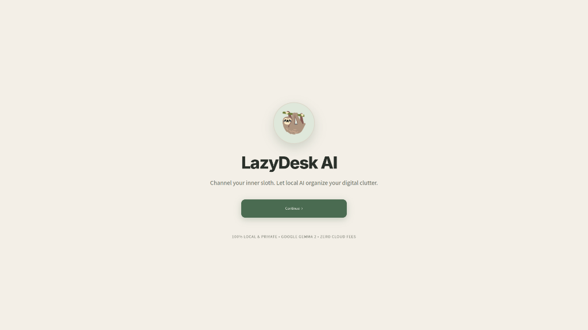
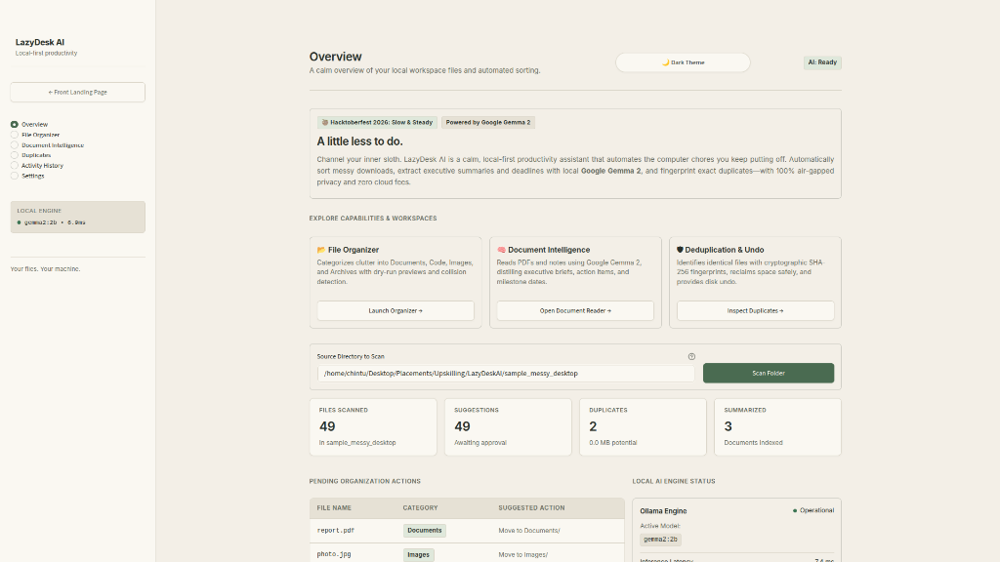
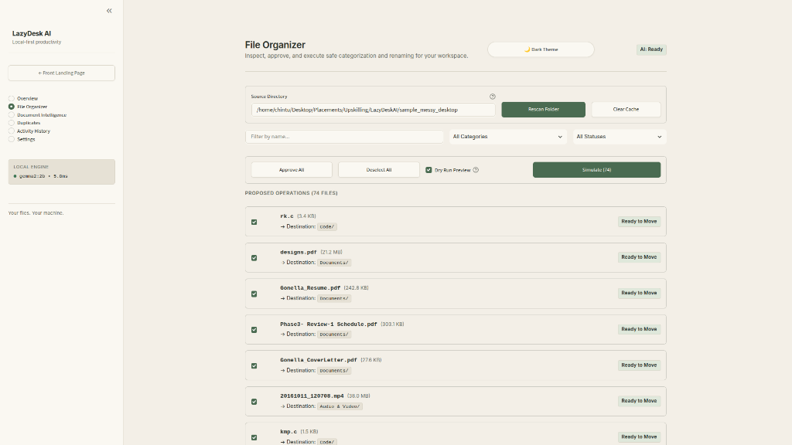
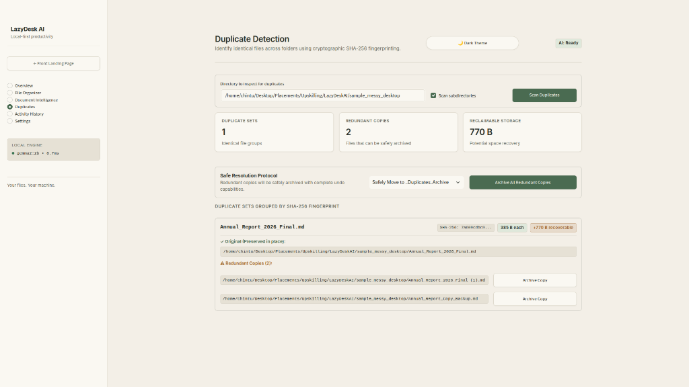
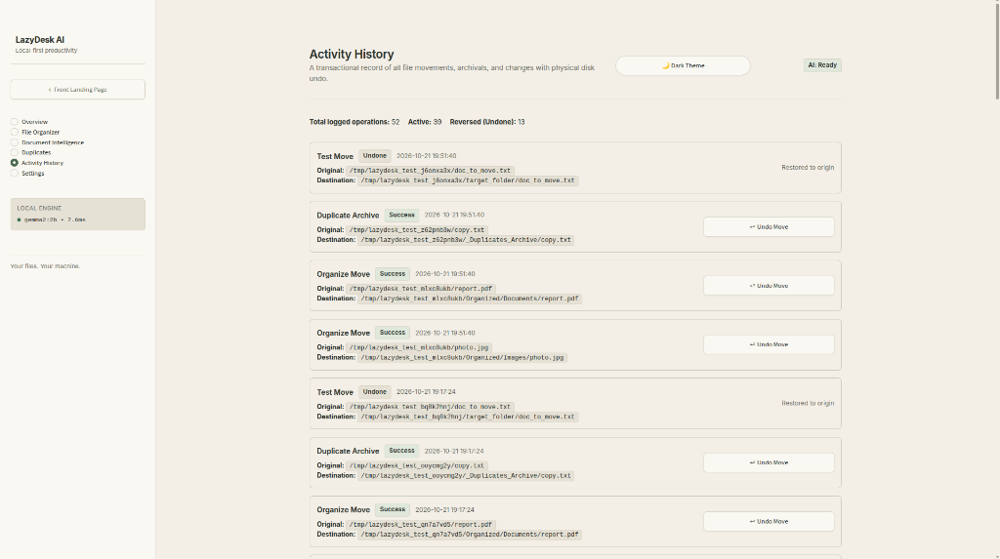

# 🌿 LazyDesk AI

> **Your calm, local-first productivity assistant.**  
> *Built with open-weight Google Gemma models for the Hacktoberfest 2026 DEV Challenge: Slow and Steady.*

[](LICENSE)
[](https://www.python.org/)
[](https://ai.google.dev/gemma)
[](https://dev.to/challenges)

---

## 🦥 The "Slow and Steady" Story

International Sloth Day reminds us that rushing through repetitive, mundane computer chores is a waste of mental energy. For most of us, our **Downloads** and **Desktop** folders are digital junk drawers overflowing with unread PDFs, duplicated invoices, untitled screenshots, and scattered spreadsheets.

**LazyDesk AI** rewards your inner sloth. Instead of spending hours manually sorting files and digging for action items:
1. One click scans your clutter.
2. Local **Google Gemma** open-weight models synthesize executive summaries and extract deadlines.
3. Safe categorization proposals are generated with dry-run previews and collision detection.
4. Cryptographic SHA-256 fingerprinting finds redundant copies to reclaim valuable gigabytes.
5. Every single move has a physical disk **Undo** button.

**Your files. Your machine. Zero cloud fees. Zero telemetry.**

---

## ✨ Features

- **Warm Editorial Aesthetic**: Built with two bespoke, accessibility-tested themes:
  - **Warm Paper (Light)**: Rich editorial tones (`#F3F0E8` background, `#FAF8F2` cards, `#496B50` forest accent).
  - **Forest Graphite (Dark)**: Muted charcoal and sage highlights (`#18231F` background, `#202C25` cards, `#A6C69A` sage accent).
  - Instant header toggle with triple persistence across reruns, browser refreshes, and SQLite DB.
- **File Organizer**:
  - Automatically identifies file extensions and routes to designated categories (Documents, Spreadsheets, Images, Code, Audio & Video, Archives).
  - Safe collision detection: Automatically proposes non-destructive renames if a target file already exists.
  - Interactive approval workflow with dry-run simulation preview.
- **Document Intelligence**:
  - Powered by local **Google Gemma** / Ollama models.
  - Extracts **Executive Summaries**, **Concrete Action Items**, and **Milestones & Deadlines**.
  - Document-reader editorial layout with instant one-click clipboard copying.
  - Graceful heuristic fallbacks so offline operation never halts.
- **Cryptographic Duplicate Detection**:
  - Two-stage grouping: fast size clustering followed by full **SHA-256** hash matching.
  - Preserves the original file in place while safely grouping redundant copies.
  - Calculates exact recoverable storage savings.
  - Safe archival protocol: Moves duplicates to `_Duplicates_Archive` or quarantine — **never deletes without confirmation**.
- **Activity History & Physical Disk Undo**:
  - Complete chronological audit log stored in local SQLite (WAL mode).
  - **Real filesystem undo**: Clicking `↩ Undo Move` physically restores the file from its new destination back to its original path on disk.

---

## 📸 Project Demo Screenshots

### 1. Minimalist Front Entrance


### 2. Overview Dashboard


### 3. File Organizer & Dry Run Simulation


### 4. Cryptographic Duplicate Detection


### 5. Activity History & Physical Disk Undo


---

## 🚀 Quickstart Guide

### 1. Prerequisites
- Python 3.10 or higher
- [Ollama](https://ollama.com/) installed locally

```bash
# Pull Google Gemma 2 (recommended for Best Use of Gemma category)
ollama pull gemma2:2b
```

### 2. Setup LazyDesk AI
```bash
# Clone the repository
git clone https://github.com/your-username/LazyDeskAI.git
cd LazyDeskAI

# Create and activate virtual environment
python3 -m venv venv
source venv/bin/activate

# Install dependencies
pip install -r requirements.txt
```

### 3. Generate Sample Sandbox (Optional)
Test the application immediately in a sandbox environment without modifying personal files:
```bash
python generate_sample_data.py
```
This generates `sample_messy_desktop/` populated with realistic documents, spreadsheets, duplicates, and screenshots.

### 4. Run the Application
```bash
streamlit run app.py --server.port 8501
```
Open **http://localhost:8501** in your browser.

---

## 🧪 Running Unit Tests

LazyDesk AI includes an automated unit test suite covering SQLite logging, duplicate hashing, file categorization, document extraction, and physical undo:

```bash
pytest tests/test_all_core.py -v
```

---

## 🛡 Why Open Innovation Matters

1. **Absolute Data Privacy (Air-Gapped Operation)**:
   Documents placed on a user's desktop include sensitive tax filings, private contracts, source code, and personal photos. Sending full-text document contents to a proprietary cloud API presents significant compliance and privacy risks. By running **Google Gemma** on-device, LazyDesk AI guarantees that not a single byte of personal data leaves the machine.
2. **Zero Operating Cost**:
   Cloud APIs charge per token. Scanning hundreds of multi-page documents on a cluttered workstation would rapidly accumulate costs. Running open-weight Gemma locally costs $0.00 forever.
3. **True Local Model Sovereignty**:
   Open-source AI empowers the user to swap between `gemma2:2b`, `gemma2:9b`, or custom fine-tunes with zero vendor lock-in.

---

## 📜 License

Distributed under the [MIT License](LICENSE).
